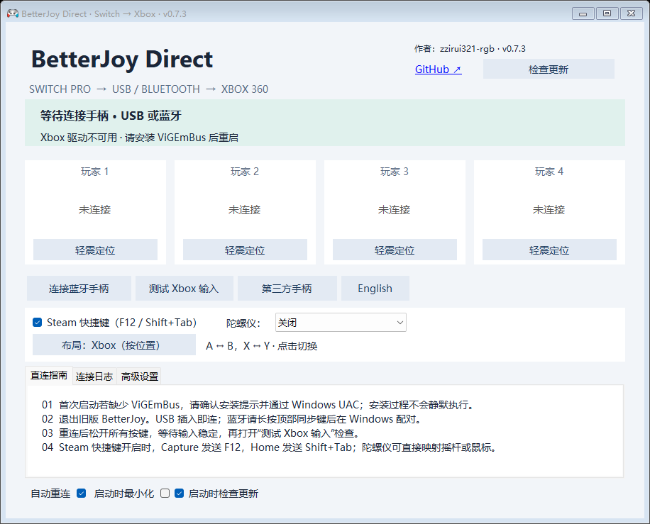

<div align="center">

# BetterJoy Direct

**接入 Switch 手柄，稳定输出 Xbox 控制。**

BetterJoy 的专注型 Windows x64 分支：更安全的重连、运行时陀螺仪控制，以及清爽的双语界面。

<p>
  
  
  
  <a href="LICENSE"></a>
</p>

<p>
  <a href="README.md">English</a>
  ·
  <a href="README.zh-CN.md"><strong>简体中文</strong></a>
  ·
  <a href="https://github.com/zzirui321-rgb/BetterJoy-Direct/releases">下载</a>
  ·
  <a href="#快速开始">快速开始</a>
  ·
  <a href="#项目文档">项目文档</a>
</p>

</div>

---

> [!NOTE]
> BetterJoy Direct 将受支持的 Nintendo Switch 手柄转换为虚拟 Xbox 360/XInput 设备。Steam 是可选项，核心 USB/蓝牙到 XInput 链路不依赖 Steam。

## 为什么选择 BetterJoy Direct？

| | |
|---|---|
| **🎮 直接输出 XInput**<br>通过 ViGEmBus 将 Switch Pro Controller 和 Joy-Con 转换为虚拟 Xbox 360 手柄。 | **🛡️ 更安全的重连**<br>拒绝异常 HID 报文，等待中立释放基线，并在重连后清除陈旧输出。 |
| **🧭 实时陀螺仪模式**<br>无需重连即可在关闭、左摇杆、右摇杆和鼠标之间切换。 | **🌐 双语界面**<br>在可缩放且托盘恢复稳定的窗口中即时切换中英文。 |
| **⌨️ Steam 快捷键**<br>可选 Capture → `F12`、Home → `Shift+Tab`，并通过按下沿保护避免连发。 | **📍 温和定位**<br>使用受强度限制的短促震动定位手柄，连续点击也不会叠加。 |

<p align="center">
  
</p>
<p align="center"><sub>四个手柄槽位、连接诊断、运行时陀螺仪控制与一键语言切换。</sub></p>

## 快速开始

### 1. 准备虚拟手柄驱动

- Windows 10 或 Windows 11 x64
- 通过 USB 或蓝牙连接的 Switch Pro Controller 或受支持的 Joy-Con

完整的 x64 发布包内含上游提供的 ViGEmBus `1.17.333.0` x64 安装程序，其 Authenticode 签名者为 Nefarius Software Solutions e.U.。首次启动时，BetterJoy Direct 若检测不到驱动，会先询问是否启动安装程序，随后由 Windows 显示正常的 UAC 管理员授权。驱动绝不会静默安装；选择**否**仍可打开界面，但不会产生虚拟 Xbox/XInput 输出。

ViGEmBus 是系统驱动，无法真正“便携化”，因此仍需完成一次管理员授权安装。其上游项目已经停止维护；BetterJoy Direct 仅为兼容性附带现有签名安装程序，不维护或重新签名该内核驱动。版本和 SHA-256 记录在 [`Drivers/README.txt`](BetterJoyForCemu/Drivers/README.txt)。

### 2. 下载并连接

1. 从 [GitHub Releases](https://github.com/zzirui321-rgb/BetterJoy-Direct/releases) 下载便携 ZIP，并完整解压。
2. 退出旧版 BetterJoy，以及可能同时打开同一物理手柄的其它映射软件。
3. 运行 `BetterJoyForCemu.exe`。
4. 若出现提示，请选择**是**、通过 Windows UAC，并完成随包 ViGEmBus 安装；如有要求，请重启 BetterJoy Direct 或 Windows。
5. USB 可直接连接；蓝牙请长按手柄同步键，然后在 Windows 蓝牙设置中配对。
6. 首次连接或重连后松开全部按键，等待至少 **300 毫秒**，让中立输入保护完成。
7. 点击 **测试 Xbox 输入**，在 Windows 游戏控制器面板中检查按键与摇杆。

> [!TIP]
> 普通按键和摇杆输出 XInput，因此 Windows 资源管理器不会响应它们。陀螺仪鼠标模式会直接移动光标。

> [!IMPORTANT]
> 不要让 Steam Input 和 BetterJoy 同时映射同一个物理手柄，否则可能出现双重输入。HidHide 仍由用户自行决定和配置；BetterJoy Direct 不会自动修改设备隐藏规则。

## 运行时控制

| 控件 | 输出 | 适用场景 |
|---|---|---|
| **布局：Nintendo（按字母）** | A→A、B→B、X→X、Y→Y | 按手柄字母匹配 Xbox 提示 |
| **布局：Xbox（按位置，默认）** | A↔B、X↔Y | 保持 Xbox 面键物理位置 |
| **Steam 快捷键** | Capture → `F12`；Home → `Shift+Tab` | Steam 截图和叠加层 |
| **关闭陀螺仪** | 不转换运动输出 | 标准 Xbox 控制 |
| **陀螺仪 → 左摇杆** | 虚拟左摇杆移动 | 实验性的移动控制 |
| **陀螺仪 → 右摇杆** | 虚拟右摇杆移动 | 兼容面更广的陀螺仪瞄准 |
| **陀螺仪 → 鼠标** | 直接移动 Windows 光标 | 鼠标视角游戏与桌面操作 |

点击布局按钮可在两种布局之间切换，对所有已连接手柄立即生效并保存，无需重启。已有单独配置的 `SwapAB` / `SwapXY` 混合值会显示为“自定义”，首次点击后切换到 Nintendo 布局。

Xbox/XInput 没有标准的原生陀螺仪字段。支持 DSU/Cemuhook 的软件可以改用可选 Motion Server。本地 Steam 游戏使用 Steam Input 原生处理陀螺仪时可能更顺滑；此时应退出 BetterJoy，或避免 Steam 同时读取物理手柄，以免产生双重输入。

## 检查更新与作者信息

窗口右上角显示作者 **B站：蓝大丶**、当前版本和 GitHub 仓库入口；GitHub 下方提供[视频入口](https://www.bilibili.com/video/BV1XUaY6hE5w)。“检查更新”读取本仓库的 GitHub 正式 Release，显示可用新版并提供更新步骤；不会自动替换程序或安装驱动。当前程序版本为 `0.7.4`。底部“更新说明”可随时查看操作步骤，无需等待发现新版。

“启动时检查更新”默认开启，可在底部关闭并记住选择。每次正常启动最多自动检查一次，不定时轮询；预览与诊断采集模式不联网检查。请求超时或 GitHub 限流时显示可重试状态，不会把失败误报为“已是最新版”，也不影响手柄输入。请求仅查询公开发布信息，不需要账号或令牌，不上传手柄数据或日志。

更新步骤：

1. 打开提示中的发布页面，下载 **BetterJoy-Direct-win-x64.zip** 并阅读发布说明。
2. 完全退出旧版，包括托盘实例。
3. 将压缩包内 `BetterJoy-Direct` 文件夹中的全部内容解压到原程序目录，选择替换同名文件；不要额外套一层同名文件夹。
4. 运行原目录中的新版程序。原路径不变时，桌面快捷方式可继续使用；已有 ViGEmBus 通常无需重装，以发布说明为准。

覆盖更新会替换 `BetterJoyForCemu.exe.config`，语言、布局及高级选项可能恢复默认；独立的 `settings` 文件不在发布包内，会保留。接受重新调整偏好时，可以直接覆盖，无需事先备份。

**可选：**希望保留配置或方便回退时，可先备份 `.config` 和 `settings`，或将新版解压到新文件夹。更新后对照备份恢复对应选项；不要直接用旧 `.config` 整体覆盖新版，以免丢失新增选项。使用新目录时，可按需复制 `settings` 并更新快捷方式。

`0.7.2` 及更早版本需要先手动安装一次含更新组件的新版，之后才会收到提醒。预发布 Release 不会作为正式更新推送；本地版本较新时不会提示降级。

## 两个蓝牙 Pro 手柄卡顿排查

新版将跨线程震动队列改为只保留最新状态，停止指令不再等待陈旧震动，并抑制重复状态写入。该代码问题已通过回归验证；双 Pro 蓝牙改善仍需反馈者实机确认，不能仅凭“蓝牙 5.3”判断适配器兼容性。

1. 在同一游戏、同一适配器上比较单个和两个 Pro 手柄。
2. 在高级设置将 `EnableRumble` 改为 `false`，保存并重启，再重复测试；结束后可恢复 `true`。
3. 退出正在运行的 BetterJoy，双击测试包中的 `Capture-Diagnostics.cmd`。它会启动隐藏的诊断实例并采集 30 秒；期间在游戏中操作两个手柄，结束后将同目录生成的 `diagnostic-*.log` 提供给维护者。分别保存震动开/关两份记录。

记录按 `padId` 区分手柄，包含有效 HID 报告间隔、同步输出提交和震动写入耗时。这些是主机端诊断指标，并非按键到画面的端到端延迟。上游也有[双蓝牙延迟反馈](https://github.com/Davidobot/BetterJoy/issues/230)和[震动相关卡顿反馈](https://github.com/Davidobot/BetterJoy/issues/316)，不能据此断言本次反馈的唯一原因。

## 可靠性链路

```text
Switch Pro / Joy-Con
        │ USB 或蓝牙 HID
        ▼
报文验证 → 重连释放门 → 校准与输入解析
        │
        ├─ ViGEmBus → Xbox 360 / XInput → 游戏或远程客户端
        ├─ 可选 Steam 快捷键 → F12 / Shift+Tab
        ├─ 可选陀螺仪 → 左摇杆 / 右摇杆 / 鼠标
        └─ 可选 Motion Server → DSU/Cemuhook 数据
```

BetterJoy Direct 只有在用户明确同意并通过 Windows UAC 后才会启动随包驱动安装程序，绝不会静默安装。它不会修改 Steam 设置、HidHide 或 Windows 设备隐藏规则。远程控制软件必须自身支持游戏手柄转发；BetterJoy Direct 无法为任意远程协议自动增加手柄通道。

## 验证概览

| 范围 | 结果 |
|---|---|
| 输入回归 | **405 项通过**——报文边界、全部 256 个 report ID、USB 传输与握手响应、时间戳、重连释放门、校准、死区、Steam 快捷键按下沿、陀螺仪方向、Guide 抑制、双 Pro 即时布局切换、震动并发与计时诊断 |
| 界面与行为 | **61 组双语文案齐全，行为检查通过**——驱动安装引导、运行时设置、窗口缩放和托盘恢复 |
| GitHub 更新检查 | **54 项通过**，并实际请求公开 API——版本排序、预发布比较、草稿拒绝、响应限长、取消和超时 |
| 虚拟 Xbox 生命周期 | **连续 3 轮通过**——创建、移动、归零与断开 |
| 实体硬件 | **蓝牙：**704 个 XInput 样本及断开/重连；**USB：**稳定 `IMU_DATA_OK`、10 秒 2346 个处理包、中立门就绪和虚拟 XInput 槽位 0 |

已验证的实体链路包括 Switch Pro Controller 蓝牙断开/重连，以及 USB 枚举、既有会话复用、报文流、中立门就绪和虚拟槽位创建。USB 逐键/逐轴动作、其它手柄型号、具体游戏、反作弊系统和具体远程控制软件仍需在各自环境中验证。

## 从源码构建

构建需要 Windows、Python 3，以及 .NET Framework 4.6.1 Developer Pack 或兼容的更新 .NET Framework 4.x 构建环境。依赖只恢复到项目目录，不进行全局安装。

```powershell
python tools/restore.py
.\build-direct.ps1
.\test-direct.ps1
.\test-features.ps1
.\test-updates.ps1
```

安装 ViGEmBus 后，还可以运行虚拟手柄生命周期测试：

```powershell
.\test-xbox-output.ps1
```

生成便携压缩包：

```powershell
python tools/package-direct.py
```

生成的程序、硬件日志、下载的工具压缩包、构建缓存和发布 ZIP 均不会进入 Git。

## 项目文档

| 文档 | 内容 |
|---|---|
| [功能与配置说明](docs/FEATURES.zh-CN.md) | 数据链路、运行时控制、高级设置、使用边界与排错 |
| [Development journey — English](docs/DEVELOPMENT-JOURNEY.md) | 从问题诊断到可验证 Direct 构建的完整过程 |
| [开发历程 — 中文](docs/DEVELOPMENT-JOURNEY.zh-CN.md) | 中文版开发过程与关键取舍 |
| [架构决策](docs/direct-mode-decision.md) | Direct 模式的范围、边界和未采用方案 |
| [更改日志](CHANGELOG.md) | 各个 Direct 里程碑的用户可见变化 |
| [上游原始 README](docs/UPSTREAM-README.md) | 原始使用说明、致谢和项目历史 |

## 上游与许可证

BetterJoy Direct 是 [Davidobot/BetterJoy](https://github.com/Davidobot/BetterJoy) 的独立衍生版本，基于上游提交 `b6715638a3ed1084f8968e8cafebbc6fe2ed0096`。它并非 BetterJoy 官方发布，原项目作者和贡献者继续保留完整署名。

项目继续使用 [MIT License](LICENSE)。便携压缩包也附带可获得的第三方依赖许可证或包元数据。
